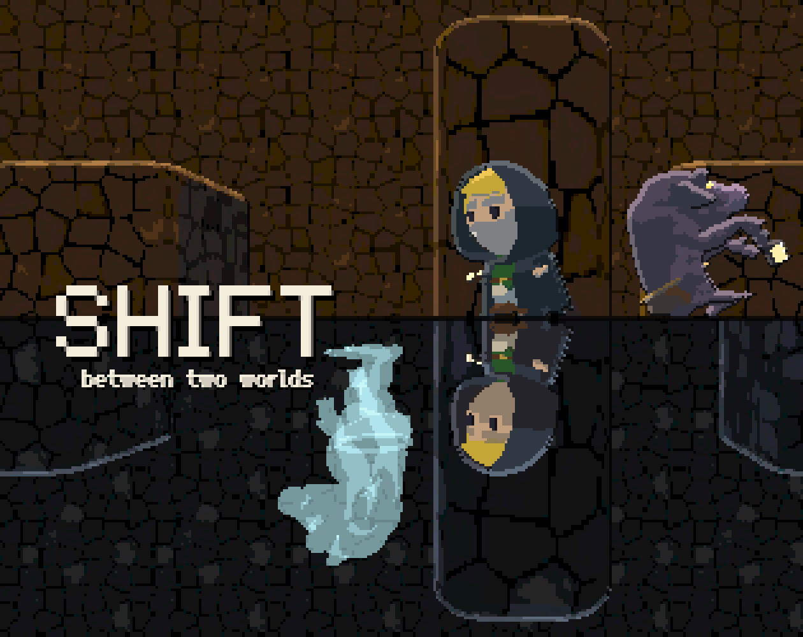

# SHIFT



兩個重疊次元的潛行探索遊戲 + 關卡編輯器。設計規則見 [DESIGN.md](DESIGN.md)（遊戲與引擎的唯一準則）。

## 執行

```bash
npm install
npm run dev        # http://localhost:5173/ 遊戲、/editor.html 編輯器
npm run check      # 型別檢查 + 單元測試 + 關卡驗證
npm run validate   # 只驗證 levels/*.json（可帶檔名）
npm run build      # 正式版 → dist/itch/ 與 dist/shift-itch.zip（見下方「正式版」）
npm run models     # 用 Blender 重建角色模型（BLENDER=<blender.exe> 或專案旁的 blender-* 資料夾）
npm run cover      # 重拍封面 → docs/（要 Chrome，見下方「上傳到 itch.io」）
```

## 操作

WASD 移動（以鏡頭為準）・滑鼠 / ←→ 轉鏡頭・**按住 Shift 潛行**（怪物視野半徑減半）・**輕點 Shift 轉移次元**（兩側腳下都是空塊時）・Space 拉桿或割喉（拉桿在範圍內時優先拉桿；割喉要從背後摸到表次元的怪物，裏次元的幽靈殺不死）

開發模式（`npm run dev`）另有：R 重來・←→ 轉鏡頭・+/− 縮放・`?level=<id>` 直接跳關・右上角編輯器連結。

## 正式版

`npm run build` 只打包遊戲本體：鍵盤只認教學頁教的 WASD、Space、Shift（滑鼠轉鏡頭與滾輪縮放保留），沒有編輯器、試玩、跳關與 R 重來。

| 輸出 | 用途 |
|---|---|
| `dist/itch/` | 正式版的檔案；要用 HTTP 伺服器開（例如 `npx vite preview`），直接雙擊 index.html 載不到模型 |
| `dist/shift-itch.zip` | `dist/itch/` 打成 zip，`index.html` 在最上層——上傳到 itch.io 的就是這一支 |

打包出來的 JS 不含授權註解，three.js 的 MIT 授權原文放在 `licenses.txt`，字型的 OFL 授權在 `fonts/`，兩者都會跟著 zip 走。

### 上傳到 itch.io

1. **Kind of project** 選 **HTML**。
2. **Uploads** 上傳 `dist/shift-itch.zip`，勾 **This file will be played in the browser**。
3. **Embed options**：**Embed in page**，視窗 1280 × 720，勾 **Fullscreen button**。
4. **Cover image** 上傳 `docs/cover-itch.png`（630 × 500，itch 建議的大小）；`docs/cover.png` 是同一張放大兩倍，放在這份 README 開頭；`docs/cover-wide.png`（1920 × 1080）是 16:9 版。三張都由 `npm run cover`（`scripts/cover.ts`）拍：開發伺服器上的攝影棚 `cover.html`（`src/cover/main.ts`）用遊戲自己的 GameView 拍一個封面專用的小關卡，用平視的鏡頭（地面完全水平）表、裏各拍一半再上下拼起來（裏次元上下翻轉），一個美術像素放大成整數倍的螢幕像素。重跑會覆寫這三個檔，結果逐位元組相同。Chrome 不在預設位置時用 `CHROME=<chrome.exe>` 指定。
5. 玩家要先點一下遊戲畫面，鍵盤才會進到遊戲（iframe 拿到焦點），同時鎖定滑鼠轉鏡頭；Esc 放開滑鼠，再點一下重新鎖定。

## 製作關卡

1. `npm run dev`，開 `/editor.html`。
2. 上方「新增」或從下拉選單開啟既有關卡。左右（或上下）兩個面板分別是次元 A、B，完全獨立。
3. 工具：**畫筆 B**（右鍵擦）・**選取 V**（編參數）・**怪物 M**（放置後自動切到路徑）・**路徑 P**（加巡邏點，右鍵刪最後一點）。數字鍵 1-8 切換方塊。
4. 顯示選項：另一側怪物路徑（遊戲中看不見，只供設計對照）、視野預覽。
5. 右側驗證即時更新：結構、頻道連結、怪物路徑、**可解性求解**（不計怪物）。點問題可跳到該格。
6. **Ctrl+Enter 試玩**，**Ctrl+S 存檔**到 `levels/<名稱>.json`；改名稱後存檔會一併改檔名（檔名只為好看）。關卡身分是 JSON 內的 `id`，遊戲依 `levels/order.json`（以 id 記錄）的順序載入關卡（在編輯器左側關卡列表拖曳即可排序；未列入的關卡按 id 排在最後）。
7. 提交前跑 `npm run check`。

關卡 JSON 一列一行，方便 diff；格式見 DESIGN.md §5。

## 架構

```
src/core/     純邏輯（無 three.js / DOM，可在 Node 測試）
  blocks.ts     方塊 registry — 唯一真相來源
  level.ts      關卡資料模型、解析、正規化序列化
  grid.ts       查詢層：實心/遮擋、轉移點、射線、碰撞
  sim.ts        確定性遊戲模擬
  solver.ts     可解性 BFS
  validate.ts   驗證器（CLI、測試、編輯器共用）
src/render/   three.js 畫面：像素管線、角色、方塊模型 registry、GameView
src/game/     輸入、主迴圈、HUD、關卡清單
src/editor/   關卡編輯器
levels/       關卡檔
tests/        單元測試（含 level01 依設計路線、怪物開啟狀態下的完整通關）
```

### 新增一種方塊

1. `src/core/blocks.ts` 加一筆（字元、名稱、顏色、參數 schema、solid/opaque、behavior）。
2. `src/render/blockModels.ts` 加同 id 的模型工廠。
3. 需要新行為時，在 `sim.ts`（遊戲）與 `solver.ts`（可解性）處理該 behavior。
4. `npm run check` — 測試會檢查字元唯一、每個方塊都有模型。

編輯器的調色盤、參數面板、驗證器會自動跟上。
